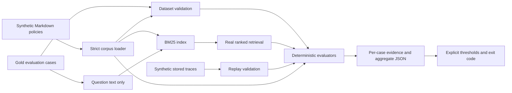

# ai-quality-evals

A compact Python framework for evaluating retrieval quality and stored response traces.
Phase 1 executes real BM25 retrieval, validates evaluation data, checks citation IDs and
exact evidence quotations, and writes auditable JSON reports with explicit regression gates.
Evaluation runs entirely offline and deterministically.

The fictional product under test is **JuniperVale Benefits**, an employee-benefits platform.
All policies, questions, answers, and traces were authored for this project. They contain
no customer records, employer-system exports, or real benefit guidance.

**There is no LLM integration in Phase 1.** Response replays are synthetic fixtures used
to verify the evaluator. Their scores do not measure a live model.

## Quick start

Python **3.13** is the local and CI baseline. The runtime has no third-party dependencies.
pytest, Ruff, and mypy are the development tools; setuptools builds the package.
The lock file pins their transitive dependencies for the Linux/macOS baseline.

```bash
python3.13 -m venv .venv
source .venv/bin/activate
python -m pip install -r requirements-dev.lock
python -m pip install --no-build-isolation --no-deps .
python -m pip check

ai-evals validate
ruff format --check .
ruff check .
mypy
python -m pytest -q
python scripts/check_offline.py
```

This builds a regular wheel containing the corpus and fixtures. Default inputs work from
any directory. After changing package code or data, reinstall before running checks.
Initial dependency installation requires PyPI or a prepopulated local wheelhouse;
runtime evaluation requires no network access.

## Current architecture



Retrieval mode executes the algorithm and does not produce an answer. Replay mode
evaluates stored rankings and synthetic response records; it runs neither retrieval nor
generation. Gold labels are used by validation and evaluation only. The retriever accepts
documents and question text, never relevant IDs, reference facts, gold evidence, or intent.

| File or directory | Responsibility |
| --- | --- |
| `src/ai_quality_evals/models.py` | Frozen typed document, case, retrieval, and response records |
| `src/ai_quality_evals/validation.py` | Strict JSONL and Markdown metadata validation |
| `src/ai_quality_evals/retrieval.py` | BM25 indexing and ranking |
| `src/ai_quality_evals/metrics.py` | Independent evaluators, aggregation, and thresholds |
| `src/ai_quality_evals/runner.py` | Orchestration, input hashes, atomic reports |
| `src/ai_quality_evals/cli.py` | `validate`, `retrieval`, and `replay` commands |
| `src/ai_quality_evals/data/kb/` | 12 current and two archived policies |
| `src/ai_quality_evals/data/cases.jsonl` | Human-authored cases, labels, and evidence |
| `src/ai_quality_evals/data/replays/` | Six good and six defective synthetic traces |
| `tests/` | Evaluator correctness and regression tests |
| `scripts/check_offline.py` | Installed-CLI smoke checks and expected failures |
| `.github/workflows/ci.yml` | Python 3.13 installation and quality checks |

## Corpus and dataset

The 14 policies cover enrollment, eligibility, dependents, qualifying life events,
medical/dental limits, wellness/commuter reimbursement, claim submission/status, appeals,
and support escalation. Each document has a stable ID, title, version, effective date,
and `current`/`archived` status in a fixed metadata header:

```text
---
id: enrollment-2026
title: Annual enrollment window for 2026
version: 2.0
effective_date: 2026-01-01
status: current
---
```

The body starts with the same title as an H1. This is a fixed `key: value` format, not a
general YAML parser. Dates use `YYYY-MM-DD`. Archived policies remain indexed to expose
confusion with current rules.

| Category | Count | Intent |
| --- | ---: | --- |
| Straightforward | 9 | Single-source facts, exclusions, and terminology |
| Multi-document | 6 | Facts required from at least two sources |
| Distractor | 5 | Old policies, shared amounts, and similar benefit rules |
| Unanswerable | 4 | Missing personal records, prices, coverage details, or topics |
| **Total** | **24** | 20 answerable cases and four unsupported questions |

Categories express the main intent; two distractor cases also need multiple sources.
Relevant IDs are the sources required to support reference facts, not every topical match.
Each JSONL line is a complete schema-version-1 case, for example:

```json
{
  "schema_version": 1,
  "case_id": "case-02",
  "question": "How many scheduled hours per week make a regular employee eligible for benefits?",
  "category": "straightforward",
  "answerable": true,
  "relevant_document_ids": ["eligibility"],
  "reference_facts": ["Regular employees need at least 20 scheduled hours per week."],
  "reference_evidence": [{
    "document_id": "eligibility",
    "quote": "Regular employees scheduled for at least 20 hours per week are eligible for benefits."
  }],
  "intent": "Identify the eligibility boundary without assuming every worker qualifies."
}
```

Validation rejects missing/extra fields, wrong types, invalid or duplicate IDs, unknown
sources, duplicate JSON keys, empty files/lines, and false gold evidence. Answerable cases
need current sources with exact evidence for every relevant document. Unanswerable cases
need empty source/evidence lists and facts explaining what is unavailable. Stable IDs
are lower-case hyphen-separated identifiers.

## Retrieval definition

BM25 indexes the document body, including its H1 title once, as case-folded ASCII
word/number tokens (`[a-z0-9]+`). It uses no stopword removal, stemming, query expansion,
embeddings, date filtering, or hardcoded query mapping. Metadata and labels are not indexed.

For corpus size `N`, document frequency `df(t)`, term frequency `tf(t,d)`, document length
`len(d)`, and average length `avg_len`:

```text
idf(t) = ln(1 + (N - df(t) + 0.5) / (df(t) + 0.5))
score(q,d) = sum over distinct matched query terms t of:
  idf(t) * tf(t,d) * (k1 + 1)
  / (tf(t,d) + k1 * (1 - b + b * len(d) / avg_len))
```

Defaults: `k1=1.5`, `b=0.75`, `top_k=3`. The API exposes BM25 parameters; the CLI exposes K.
Sorted query terms and document IDs stabilize computation across hash seeds. Only positive
scores are returned. Full-precision ties break by ascending document ID; public scores
round to 12 decimals after ranking. Results carry query text, requested K, IDs, and scores.

## Metrics and aggregation

| Metric | Exact definition | Aggregate denominator |
| --- | --- | --- |
| `recall_at_k` | Distinct gold IDs found in the first K positions / distinct gold IDs | Macro mean over cases with gold sources |
| `mrr` | Mean reciprocal rank: `1/r` for the first gold source at rank `r <= K`, otherwise `0` | Same answerable cases; MRR at the reported cutoff K |
| `citation_validity` | Cited document ID exists in the corpus | Micro fraction over all citation entries |
| `exact_quote_validity` | Nonblank quote is a case-sensitive exact substring of the specified document body, and that ID is in the response citation list | Micro fraction over all evidence entries |
| `answerability_accuracy` | Trace outcome `answer` agrees with gold `true`, or `abstain` agrees with `false` | Fraction over response traces |
| `citation_coverage` | An `answer` response includes at least one citation | Fraction over responses declaring `answer` |
| `evidence_coverage` | An `answer` response includes at least one evidence quote | Fraction over responses declaring `answer` |

Empty denominators yield JSON `null`, not an artificial perfect score. Unanswerable cases
have null retrieval metrics and remain in the report. Retrieval mode has null response
metrics. Aggregates include denominators and category breakdowns. Combine coverage and
validity gates so omitted citations/quotes cannot conceal defects.

Citation audit fields also show whether a source was retrieved and whether it is archived;
these are diagnostics, not extra aggregate quality claims. Invalid cited IDs and invented
quotations pass structural parsing so evaluators can flag prediction defects. Schema
integrity is enforced before evaluation, rather than averaged into a quality score.

## Commands and gates

```bash
ai-evals validate --traces src/ai_quality_evals/data/replays/good.jsonl

ai-evals retrieval --top-k 3 \
  --minimum recall_at_k=0.95 --minimum mrr=0.90 \
  --output reports/retrieval.json

ai-evals replay --traces src/ai_quality_evals/data/replays/good.jsonl \
  --minimum recall_at_k=1 --minimum mrr=1 \
  --minimum citation_validity=1 --minimum exact_quote_validity=1 \
  --minimum answerability_accuracy=1 \
  --minimum citation_coverage=1 --minimum evidence_coverage=1 \
  --output reports/replay-good.json
```

`python -m ai_quality_evals` is an equivalent entry point. All commands accept `--kb` and
`--cases` overrides. Replay requires `--traces`; validate optionally checks traces. Default
evaluation output is `reports/<mode>.json`.

Minimums are explicit, inclusive bounds in `[0,1]`. Report gate status distinguishes
observation-only evaluation from a configured quality gate:

| Configuration/outcome | `gate_status` | `passed` | CLI output | Exit |
| --- | --- | --- | --- | ---: |
| No thresholds configured | `not_evaluated` | `null` | `OBSERVATION ONLY (no thresholds configured)` | 0 |
| All configured minimums met | `passed` | `true` | `PASS` | 0 |
| Any configured minimum violated | `failed` | `false` | `FAIL` | 1 |

These fields describe configured gates, not correctness of every answer. A defective
replay without thresholds has `gate_status: "not_evaluated"` and `passed: null`, even
though valid execution exits zero. A requested metric with no observations fails its
configured gate, even for a minimum of zero.

| Exit | Meaning |
| --- | --- |
| `0` | Valid execution; configured minimums met, or no minimums requested |
| `1` | Configured gate failed; full diagnostic report written |
| `2` | Invalid input/configuration, usage error, or file-system error |

Replays intentionally cover subsets. Reports identify dataset/evaluated counts and every
omitted case ID. Each trace requires `schema_version`, `case_id`, and
`trace_origin: "synthetic_fixture"`, plus these nested records:

```json
{
  "retrieval": {
    "query": "The exact dataset question",
    "top_k": 3,
    "hits": [{"document_id": "eligibility", "score": 4.2}]
  },
  "response": {
    "outcome": "answer",
    "text": "Regular employees need at least 20 scheduled hours per week.",
    "citations": ["eligibility"],
    "evidence": [{
      "document_id": "eligibility",
      "quote": "Regular employees scheduled for at least 20 hours per week are eligible for benefits."
    }]
  }
}
```

This snippet illustrates nested fields, not a complete trace. Query must equal the case
question; hit IDs must exist and be unique, scores finite/nonnegative and nonincreasing,
and hit count no greater than stored K. Evaluation K may be lower than stored K but cannot
be higher. Replay scores are fixture values, not measured BM25 or model scores.

## Example results

| Mode | Cases | Recall@K | MRR@K | Citation validity | Exact quote validity | Answerability |
| --- | ---: | ---: | ---: | ---: | ---: | ---: |
| Real BM25, K=3 | 24 | 1.000 | 0.950 | N/A | N/A | N/A |
| Good synthetic replay, K=3 | 6 | 1.000 | 1.000 | 1.000 | 1.000 | 1.000 |
| Defective synthetic replay, K=3 | 6 | 0.375 | 0.500 | 0.800 | 0.400 | 0.667 |
| Real BM25, K=1 | 24 | 0.700 | 0.900 | N/A | N/A | N/A |

Four unanswerable cases are excluded from retrieval averages, leaving 20 observations.
Each replay has four answerable and two unanswerable cases. `case-16` and `case-17` rank
archived policies first and current sources second: Recall@3 passes, reciprocal rank is
0.5. These remain visible limitations of lexical ranking.

A failed report excerpt:

```json
{
  "mode": "replay",
  "response_origin": "synthetic_fixture",
  "evaluation_k": 3,
  "gate_status": "failed",
  "passed": false,
  "threshold_failures": [{
    "metric": "exact_quote_validity",
    "minimum": 1.0,
    "actual": 0.4,
    "reason": "below_minimum"
  }]
}
```

Full reports include input SHA-256 hashes, evaluator version, retrieval configuration,
questions, gold facts/sources/quotes, ranked hits/scores, response text, citation checks,
quotation failure reasons, denominators, category summaries, and omitted cases. There are
no timestamps or absolute input paths; identical inputs/configuration produce byte-identical
JSON. Report replacement is atomic.

Both commands below demonstrate meaningful failures and exit **1**:

```bash
ai-evals replay --traces src/ai_quality_evals/data/replays/bad.jsonl \
  --minimum citation_validity=1 --minimum exact_quote_validity=1 \
  --minimum answerability_accuracy=1 --output reports/replay-bad.json

ai-evals retrieval --top-k 1 --minimum recall_at_k=0.95 \
  --output reports/retrieval-k1.json
```

## Verification and CI

Tests use independent expected values for BM25, retrieval metrics, macro/micro aggregation,
bad schemas, citations/quotes, empty denominators, threshold boundaries, CLI exit codes,
reports, and serialization across Python hash seeds. A test disables socket creation during
both modes. A false answer with a real citation and exact quote explicitly demonstrates
the limits of structural checks.

GitHub Actions installs the pinned environment and package on Python 3.13, runs Ruff,
strict mypy, pytest, and the smoke script. Smoke checks require both passing gates and
expected exit-1 failures, plus an observation-only defective replay with `passed: null`;
unexpected gate status, success, or an input-error exit fails CI. JSON artifacts
are uploaded even after failures. Actions are pinned to commit SHAs. No API keys or paid
inference calls are used. Initial package installation and artifact upload use network;
the evaluations do not.

Reports, virtual environments, caches, build outputs, and `.env` files are Git-ignored.
Synthetic source data and replays are intentionally versioned. See the
[Phase 1 verification report](docs/phase1-report.md) for the verified outcome.

## Scope and limitations

- This small authored corpus is an auditable engineering baseline, not a representative
  production benchmark or a statistical estimate of general model quality.
- BM25 measures lexical retrieval and has no semantic understanding or freshness selection.
  It can rank an archived policy ahead of a current one.
- Citation existence does not establish relevance, currency, or answer support. Exact quote
  validation establishes provenance of supplied text, not that response claims follow from
  it. Neither metric detects all hallucinations or measures semantic faithfulness.
- Answerability accuracy checks a declared outcome, not free-form answer correctness.
  Reference facts are reviewer annotations, not a semantic grader.
- Replays validate evaluator behavior; no live retrieval/generation pipeline produced their
  synthetic response records.
- No model API, LLM-as-a-Judge, chatbot, agent workflow, vector store, database, server,
  Docker setup, or cloud infrastructure is implemented.

## Planned next phase

Phase 2 should add a small real RAG integration with opt-in live model calls, explicit cost
controls, and captured model/configuration/context/response provenance. Preserve this
offline suite as the evaluator regression layer, and report live model performance
separately. Add independently reviewed answer-quality labels and more difficult retrieval
cases before proposing production gates. Agent tool-call evaluation remains later work.
