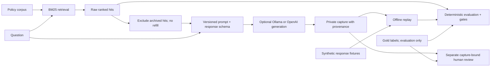

# ai-quality-evals

## Overview

An offline-first Python RAG/LLM quality evaluation framework built as a QA/SDET portfolio
project. It separates retrieval testing, response validation, and human semantic review
so that a passing structural check is never presented as proof of a correct answer.

The test domain is **JuniperVale Benefits**, a fictional employee-benefits platform.
Its 14 policy documents and evaluation data are authored examples with no customer records
or real benefit guidance. Synthetic fixtures test evaluator behavior; actual model captures
are recorded separately and kept private.

## Project Highlights

- **24 authored evaluation scenarios:** straightforward, multi-document, distractor, and
  unanswerable questions, with reference facts and exact source evidence.
- **BM25 retrieval and deterministic offline replay:** explicit regression gates and
  auditable JSON reports with input hashes, per-case diagnostics, and metric denominators.
- **Local Ollama inference using `qwen2.5:3b`:** optional generation followed by offline replay.
- **Optional OpenAI Responses API provider:** explicit opt-in, bounded requests, and a
  separately installed SDK.
- **Six deterministic response-consistency rules:** observable conflicts between
  `answer`/`abstain` outcomes, citations, evidence, and explanation text.
- **Capture-bound human semantic review:** SHA-256-bound annotations, a five-dimension
  rubric, and paired comparisons kept separate from automatic metrics and gates.
- **Automated verification:** pytest, Ruff, strict mypy, offline CLI smoke checks, and
  GitHub Actions, including an offline SDK contract check.

## Key Experiment

A local Ollama experiment compared the default `benefits_rag_v1` with experimental
`benefits_rag_v2`, using `qwen2.5:3b` and matching cases, retrieval context, and generation
settings within each pair.

| Measure | v1 | v2 | Scope |
| --- | ---: | ---: | --- |
| Automatic answerability accuracy | 3/8 | 6/8 | Four selected cases, repeated in two runs per prompt |
| Human answer correctness, mean on a 0–2 scale | 2.0/2 | 1.0/2 | Run 02 only; four paired applicable cases |

Answerability accuracy checks the declared `answer`/`abstain` outcome against the gold
label; it does not assess factual correctness. Human review of v2 run 02 found an
**evidence contradiction** (equating dental and medical limits despite contrary quoted
text) and an **unsupported personal claim** (asserting a claim was paid using only a
status definition). These were manual semantic findings.

**v1 remains the default; v2 remains experimental** and requires explicit
`--prompt-version benefits_rag_v2`. Four distinct questions, two repeated runs, and a
human review limited to run 02 are a small regression probe. Model variation and reviewer
subjectivity limit the comparison; no statistical significance or general model-quality
improvement is claimed. See the [full findings and limitations](docs/prompt-ab-findings.md).

## Quick Start

Use **Python 3.13**, the local and CI baseline. From the repository root:

```bash
python3.13 -m venv .venv
source .venv/bin/activate
python -m pip install -r requirements-dev.lock
python -m pip install --no-build-isolation --no-deps .
python -m pip check

ai-evals validate

ai-evals retrieval --top-k 3 \
  --minimum recall_at_k=0.95 --minimum mrr=0.90 \
  --output reports/retrieval.json

ai-evals replay --traces src/ai_quality_evals/data/replays/good.jsonl \
  --minimum recall_at_k=1 --minimum mrr=1 \
  --minimum citation_validity=1 --minimum exact_quote_validity=1 \
  --minimum answerability_accuracy=1 \
  --minimum citation_coverage=1 --minimum evidence_coverage=1 \
  --output reports/replay-good.json
```

The offline runtime has no third-party dependencies. Installation needs PyPI or a local
wheelhouse; retrieval and replay need no network. The wheel bundles default data for use
from any directory. Run the relative-path examples above from the repository root, and
reinstall after changing package code or data. `python -m ai_quality_evals` is an equivalent
CLI entry point; `--kb` and `--cases` select custom inputs.

### Optional local inference

Follow the [Ollama setup guide](docs/local-ollama.md) to install `qwen2.5:3b` and start
Ollama with cloud features disabled. Model download requires network access; subsequent
inference uses the local loopback API. Then run a bounded batch and replay its capture:

```bash
ai-evals live --provider ollama --allow-live --model qwen2.5:3b \
  --max-cases 3 --timeout 120 --max-output-tokens 800 \
  --captures live-captures/qwen-local-run/traces.jsonl

ai-evals replay --traces live-captures/qwen-local-run/traces.jsonl \
  --minimum generation_success_rate=1 --minimum citation_in_context=1 \
  --minimum context_quote_validity=1 --minimum current_citation_rate=1 \
  --output live-captures/qwen-local-run/replay.json
```

Choose a fresh capture path for each live run. Live captures and their reports must stay
under Git-ignored `live-captures/`; replay makes no inference requests.

### Optional OpenAI inference

Install the SDK with `python -m pip install '.[live]'` (or install
`requirements-live.lock` first for pinned transitive dependencies). Set `OPENAI_API_KEY`
through your shell environment or secret manager, then select a model your account can
access that supports the Responses API and strict Structured Outputs:

```bash
ai-evals live --allow-live --model MODEL_ID --max-cases 3 \
  --case case-02 --case case-17 --case case-21 \
  --timeout 30 --max-output-tokens 800 \
  --captures live-captures/my-reviewed-run/traces.jsonl
```

OpenAI is the default provider for `live`; `--allow-live` explicitly opts into potentially
paid requests. See the [live RAG guide](docs/live-rag.md) for provider and request controls.

## Architecture



Retrieval mode runs BM25 without generating an answer. Replay evaluates stored rankings
and responses without retrieval or generation. Live mode retrieves, filters context,
captures each generation attempt, and invokes the offline evaluator. Gold labels and
reference answers never enter retrieval or provider requests.

| Modules | Responsibility |
| --- | --- |
| `models.py`, `validation.py` | Typed records and strict input validation |
| `retrieval.py`, `prompt.py` | BM25 ranking, versioned prompts, and context policy |
| `provider.py`, `ollama.py` | OpenAI Responses API and native local Ollama adapters |
| `live.py`, `capture.py` | Bounded generation, durable captures, and provenance checks |
| `metrics.py`, `runner.py`, `cli.py` | Evaluation, thresholds, reports, and CLI orchestration |
| `consistency.py`, `review.py`, `review_cli.py` | Six consistency rules and offline human-review workflows |

Modules live under [`src/ai_quality_evals/`](src/ai_quality_evals/).

## Evaluation Capabilities

- **Retrieval:** Recall@K and MRR@K against authored relevant sources. Archived policies
  remain indexed to expose ranking defects; generation excludes them without replacement.
- **Response structure and provenance:** citation existence, exact quotations, answerability
  classification, and citation/evidence coverage. Captured responses add context membership,
  current-source checks, effective context coverage, and generation success rate.
- **Response consistency:** six explicit rules flag citations or evidence on abstentions,
  missing citations or evidence on answers, uncited evidence sources, and abstention
  explanations with no alphabetic characters. They do not judge arbitrary claim correctness.
- **Human semantic review:** `ai-evals review prepare`, `review validate`, and
  `review summarize` support manual ratings of correctness, abstention, citation support,
  groundedness, and necessary-fact coverage. Unreviewed outputs have no human score.
- **Regression gates:** explicit inclusive `--minimum metric=value` thresholds. Without
  thresholds, reports are observation-only (`passed: null`). Exit codes are `0` for valid
  observation/pass, `1` for a failed gate, and `2` for input, configuration, or captured
  generation failure. Empty metric denominators are null and fail a requested gate.

Identical replay inputs and configuration produce byte-identical JSON reports. Reports
retain omitted case IDs, denominators, hashes, and captured model metadata; provider
failures remain distinct from model abstentions. See the [metric and capture contract](docs/live-rag.md)
and [semantic evaluation workflow](docs/semantic-evaluation.md) for definitions and limits.

## Verification

Run these checks in the installed development environment:

```bash
ruff format --check .
ruff check .
mypy
python -m pytest -q
python scripts/check_offline.py
python scripts/check_captures_offline.py
```

[GitHub Actions](https://github.com/rmpetrov/ai-quality-evals/actions/workflows/ci.yml)
runs the pinned Python 3.13 checks on pushes and pull requests. The
[main-branch run for commit `241059b`](https://github.com/rmpetrov/ai-quality-evals/actions/runs/38673222290)
completed successfully. The [`quality` job](.github/workflows/ci.yml) covers evaluator tests,
strict typing, lint/format checks, deterministic replay, and expected CLI failure paths.
The separate `sdk-contract` job installs `requirements-live.lock` and runs
`python scripts/check_sdk_offline.py` with a dummy credential, mocked HTTP responses, and
blocked request sockets. Neither job downloads models or performs real inference.

## Technical Documentation

| Guide | Content |
| --- | --- |
| [Prompt A/B findings](docs/prompt-ab-findings.md) | Results, human findings, limitations, and the v1 default decision |
| [Offline semantic evaluation](docs/semantic-evaluation.md) | Consistency rules, capture-bound annotations, and paired comparison commands |
| [Human review rubric](docs/human-review.md) | Five rating dimensions, applicability, and reviewer guidance |
| [Local Ollama](docs/local-ollama.md) | Setup, local generation, capture provenance, and replay commands |
| [Live RAG contract](docs/live-rag.md) | OpenAI integration, schemas, context policy, metrics, and failure handling |
| [Prompt consistency procedure](docs/prompt-consistency.md) | Controlled A/B commands and prompt provenance |
| [Phase 1 report](docs/phase1-report.md) / [Phase 2 report](docs/phase2-report.md) | Historical implementation and verification reports |

## Limitations

- The small authored corpus and selected experiment cases are an engineering baseline,
  not a representative production benchmark. Synthetic replay scores test the evaluators.
- BM25 is lexical and can rank archived policies above current ones. Filtering does not
  recover a current source that falls outside the retrieved top K.
- Valid citations and exact quotes establish provenance, not semantic support. Automatic
  checks do not establish factual correctness or provide general semantic hallucination
  detection. Human findings and ratings remain separate from automated gates.
- Deterministic replay reproduces evaluation of fixed captures; future model generations
  can vary. Manual judgments are subjective, and no inter-rater agreement is established.
- Raw model captures, human annotations, reviewer identities, and credentials remain
  private. Published experiment aggregates alone cannot reconstruct the full human review.
