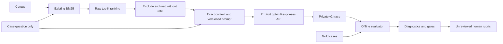

# Phase 2 completion and verification report

Verified locally on October 13, 2026, on macOS with Python 3.13.3.

**Final verdict: READY FOR PR.** Implementation and offline verification are complete.
Real-provider execution and model quality remain unverified: no authorized paid inference
was performed. No commit, push, merge or PR was created. Work stops at Phase 2 for review.

## 1. Architecture changes

The initial review covered models, retrieval, validation, metrics, runner, CLI, all 14 corpus
documents, 24 cases, both synthetic replay files, tests, smoke script and CI workflow.
The existing immutable records, independent metric functions and replay orchestration were
suitable extension points; the evaluation framework was retained.

Four small runtime modules add prompt/context construction, one provider adapter, strict
capture validation and sequential RAG orchestration. The CLI captures generation then
runs the ordinary replay evaluator, so automatic live-run reports intentionally use mode
`replay`, with explicit `response_origin: live_capture` provenance. Only a real default SDK
transport can produce live-origin records; injected providers/transports declare simulation.



## 2. Added and modified files

Added:

| File | Purpose |
| --- | --- |
| `src/ai_quality_evals/prompt.py` | Single versioned prompt, schema, settings and archived context policy |
| `src/ai_quality_evals/provider.py` | Minimal typed provider and lazy official SDK adapter |
| `src/ai_quality_evals/capture.py` | Strict v2 snapshots, hash checks, incremental trace persistence |
| `src/ai_quality_evals/live.py` | Bounded sequential generation using real BM25/context |
| `tests/test_live.py` | End-to-end fake-provider, replay, limits and evaluation tests |
| `tests/test_provider.py` | Adapter requests, parsing, error mapping and redaction |
| `tests/fixtures/captured-format.jsonl` | Two explicitly simulated v2 format examples |
| `scripts/check_captures_offline.py` | Installed CLI failure paths and deterministic fixture replay |
| `scripts/check_sdk_offline.py` | Official-SDK check with local mock HTTP transport, also run by the separate SDK CI job |
| `requirements-live.lock` | Pinned optional SDK transitive environment |
| `docs/live-rag.md` | Technical contract, definitions, denominators and limitations |
| `docs/human-review.md` | Reviewer-owned rubric; no automatic human scores |
| `docs/phase2-report.md` | This implementation and verification report |

Modified:

| File | Change |
| --- | --- |
| `models.py` | Frozen request, settings, context, provider and capture types |
| `validation.py` | Shared strict JSON/response/retrieval parsers and v2 dispatch |
| `metrics.py` | Five narrow context/operational checks, retaining Phase 1 definitions |
| `runner.py` | Provenance-preserving captured replay and v2 report fields |
| `cli.py` | Explicit live opt-in, selection/limits, private artifacts and diagnostics |
| `__init__.py` | Package version 0.2.0; accurate scope description |
| `pyproject.toml` | Version 0.2.0 and optional `live` extra |
| `.gitignore` | Ignore private `live-captures/` |
| `.github/workflows/ci.yml` | Additional offline smoke check; explicit artifact allowlist |
| `tests/conftest.py` | Remove API key and prohibit sockets for every pytest test |
| `tests/test_validation.py` | Explicit non-null assertion for the extended record union |
| `README.md` | Live setup, commands, architecture, replay, controls and limitations |

The corpus, case dataset, Phase 1 synthetic replays, BM25 implementation, development lock
and original smoke script are unchanged. Phase 1 report field/metric sets are retained;
the evaluator version advances to 0.2.0. V2 additions appear only for v2 inputs.

## 3. Live API integration

The optional extra pins `openai==3.29.0`, using the official Python SDK's Responses API.
Implementation reviewed official [SDK documentation](https://developers.openai.com/api/reference/python),
[Responses create reference](https://developers.openai.com/api/reference/python/resources/responses/methods/create)
and [Structured Outputs guide](https://developers.openai.com/api/docs/guides/structured-outputs?api-mode=responses).

The SDK reads `OPENAI_API_KEY` only for explicit live construction. Model selection is
mandatory; timeout and output tokens are explicit; `max_retries=0` and `store=False`.
There are no tools, conversation history, model substitutions or synthetic fallback.
Authentication, rate limits, connection errors, timeouts, provider failure statuses,
incomplete output, refusals and malformed output produce distinct diagnostics. Response
IDs, request IDs, returned model and reported usage are preserved when available.
Credential redaction applies to captured provider text/messages; headers and raw HTTP error
bodies are not logged or saved. The typed provider interface accepts no gold labels.

## 4. Prompt and context policy

`benefits_rag_v1` requires supplied-current-document-only guidance, exact supporting quotes,
source IDs, appropriate abstention and no unsupported personal eligibility decision. Both
the question and retrieved documents are marked untrusted data. The prompt hash covers
version, instructions and schema; exact serialized user input is independently recorded.

`exclude_archived_v1` preserves raw BM25 scores/order, includes current hits in relative
rank order, and records excluded archived document snapshots plus reason `archived_policy`.
It does not refill the context. Cases 16 and 17 exercise archived-first distractors at
K=1 and K=3. Raw retrieval recall/rank and effective generation coverage remain separate.
Gold facts, evidence, source labels, intent and answerability never enter the model request.

## 5. Response schema

Required fields: `outcome` (`answer` or `abstain`), nonblank `text`, unique stable-ID
`citations`, and unique `evidence` objects with `document_id` and nonblank exact `quote`.
The strict API schema forbids additional properties. Independent offline validation
rejects duplicate JSON keys, malformed IDs and invalid types. Prediction-quality defects
such as missing citations, unknown IDs and invented quotes are retained for evaluation.
A provider refusal/error is not an `abstain` response and has null parsed response.

## 6. Provenance captured

V2 records include case/question, raw retrieved IDs/scores/K, all retrieved document
snapshots (supplied or excluded), exact supplied context/input, prompt version/hash/schema,
requested/returned model, timeout/output/retry settings, raw/parsed output, response/request
IDs, reported input/output/total tokens, measured request latency, generation status/error,
and corpus/dataset SHA-256 hashes. Missing usage or metadata stays null. Dollar pricing is
not invented. Live and simulated executions have separate origin/execution labels.

## 7. Evaluators

Reused unchanged definitions: Recall@K, MRR@K, corpus citation validity, corpus exact quote
validity, gold answerability agreement, citation coverage and evidence coverage.

V2-only additions: citation membership in actual context, exact quote validity against
supplied document bodies, current-source citation rate, effective relevant-source context
coverage and generation success rate. Counts/null behavior are defined in `live-rag.md`.
Unknown or archived citations fail current-source checks. Generation failures are included
in generation-success denominators and excluded from parsed-response denominators.

No semantic correctness or hallucination claim is made. Human review stays null until
reviewer-supplied ratings exist; no LLM-as-a-Judge is implemented.

## 8. Automated tests and results

| Verification | Actual result |
| --- | --- |
| Fresh `.venv-phase2` installation from unchanged development lock and regular wheel | Passed; `pip check` reports no broken requirements; OpenAI SDK absent |
| Fresh `.venv-phase2-live` optional SDK/extra installation, regular final wheel | Passed; `pip check` reports no broken requirements |
| `ruff format --check .` | Passed; 23 Python files formatted |
| `ruff check .` | Passed |
| Strict `mypy` | Passed; no issues in 23 source/test/script files |
| Complete pytest | **206 passed**; includes all 135 original tests and 71 new cases |
| Original `scripts/check_offline.py` | Passed all expected passes, gate failures and observation-only execution |
| `scripts/check_captures_offline.py` | Passed deterministic v2 simulation replay and keyless CLI failure paths |
| Optional `scripts/check_sdk_offline.py` | **8 scenarios passed**, actual SDK 3.29.0 through HTTPX2 MockTransport, sockets disabled |
| `git diff --check` | Passed |
| Git artifact audit | No credential-shaped literals or actual live captures among publishable file candidates |
| Corpus/case/replay diff audit | No changes to Phase 1 data |
| Ignore-path verification | Private captures/reports, `.env` and generated offline reports are ignored |

The actual-SDK scenarios simulate success, HTTP 401, HTTP 429, HTTP 500, transport timeout,
incomplete response, refusal and malformed output. All send exactly one local mock request;
no SDK retries, provider network connections or paid calls occur. Core tests additionally
cover provider connection errors, missing usage/model metadata, changed model aliases,
invalid citations/quotes, omitted context sources, archived misuse, correct/incorrect
abstention, malformed traces/output, request limits, explicit model/opt-in, missing key/SDK,
exit codes, tampering and byte-identical replay across hash seeds.

## 9. Offline determinism and CI safety

Phase 1 baseline stays Recall@3 **1.000**, MRR@3 **0.950**, over 20 answerable retrieval cases.
Good synthetic replay passes its original seven gates; defective replay and degraded K=1
retrieval fail as expected. K=1 recall remains **0.700** and MRR **0.900**.

Saved input replay runs no retrieval or provider generation. Latency, usage, response IDs
and returned model remain captured facts, rather than being recomputed. A standalone
snapshot loader works without gold inputs; gold-based scoring requires original hashed
corpus/dataset. Original questions and exact document snapshots are verified on replay.

Every pytest test removes `OPENAI_API_KEY` and blocks sockets. A separate subprocess test
blocks SDK imports while importing offline modules and executing retrieval/v2 replay.
The Actions `quality` job installs only offline dependencies and runs both offline smoke
scripts alongside its existing checks and gates. The separate `sdk-contract` job installs
the pinned optional SDK dependencies and local package on Python 3.13, then executes the
official-SDK script exclusively through local MockTransport responses with sockets blocked
during requests. No real API key, live inference, provider secrets or scheduled evaluations
are used. Artifact upload lists only named offline and simulated reports, never private
live traces. CI coverage changes were verified locally; this unpushed branch has not
executed the updated workflow on GitHub Actions.

## 10. Cost and request controls

Required CLI: `ai-evals live --allow-live --model MODEL_ID`. Defaults: maximum three cases,
K=3, 30-second SDK timeout, 800 max output tokens. Maximum batch size is 24; output-token
bounds are 16–4096. Explicit selections must fit the count; invalid inputs/thresholds fail
before provider invocation. The CLI prints intended count first. Calls are sequential,
retries are disabled, and the first provider/generation failure stops further requests.

Actual reported usage is saved; missing usage is unknown. Configured count/token limits
and transport timeouts do not guarantee a strict USD cap, cancellation or absence of
billing after timeout. No prices/cost estimates are fabricated. Trace files are created
exclusively and flushed after each result; existing outputs are refused. Actual artifacts
must stay under Git-ignored `live-captures/`.

## 11. Real-provider verification status

**Not executed.** There was no separate authorization for paid API calls, so none were made.
SDK request serialization, response parsing, usage/model metadata and SDK exception behavior
were checked with local simulated transports, not the OpenAI service. Actual account access,
model capability/availability, real refusals/rate limits, inference latency and benefit-answer
quality remain unverified. No real capture or live benchmark score is claimed.

A separately authorized small batch is the next practical smoke check after review, using
an explicitly selected Responses/Structured Outputs-capable model. It is not scheduled
or automatically initiated by this implementation.

## 12. Known evaluation limitations

An explicit test returns **200 scheduled hours** while quoting the policy's **20 hours**.
Every structural metric still passes. Citation existence, context membership, policy
status and literal quotations do not establish claim support, semantic faithfulness,
answer correctness, complete reference-fact coverage or hallucination-free generation.
Reports repeat this limitation and all human ratings stay unreviewed.

Corpus metadata drives policy currency; there is no clock-based freshness reasoning.
Archived exclusion deliberately limits historical-policy questions. Gold answerability
can disagree with legitimate abstention caused by missing retrieved context. Successful-only
response metrics require generation-success/count inspection. A small authored synthetic
corpus is not a representative production benchmark. Live output can vary; deterministic
replay guarantees only stable evaluation of fixed recorded inputs. Sudden process termination
before a provider result arrives cannot preserve an unavailable result. No agents, UI,
vector store, multi-provider framework, cloud infrastructure or model judge is included.

## 13. Recommended commit message

```text
feat: add opt-in live RAG generation and deterministic captured replay
```

## 14. Final verdict and Git state

**READY FOR PR**, with the disclosed limitation that real paid provider execution is unverified.
The working tree was initially clean on `main`; `origin/main` was fetched, and
`feat/live-rag-evaluation` was created from commit `8a77787`. All changes remain uncommitted
on that branch for review. No push, merge or PR was performed. Phase 2 work stops here.
